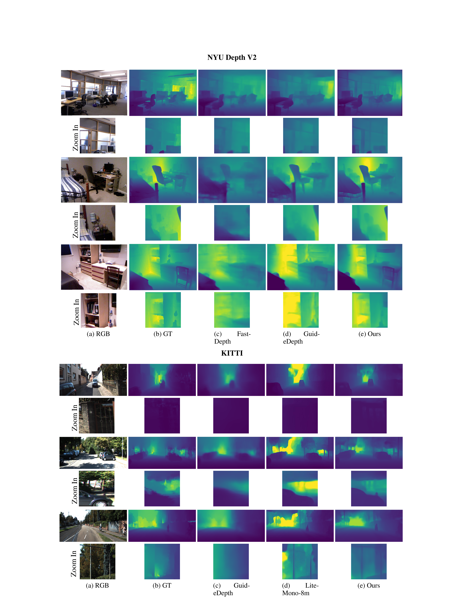
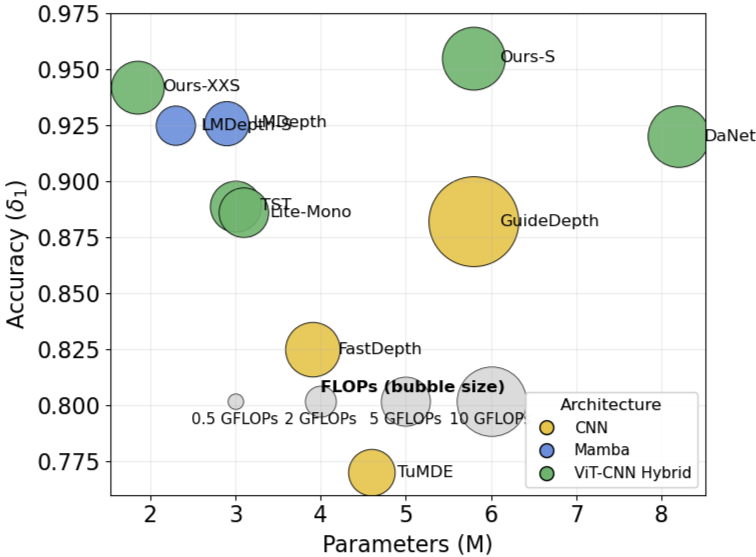
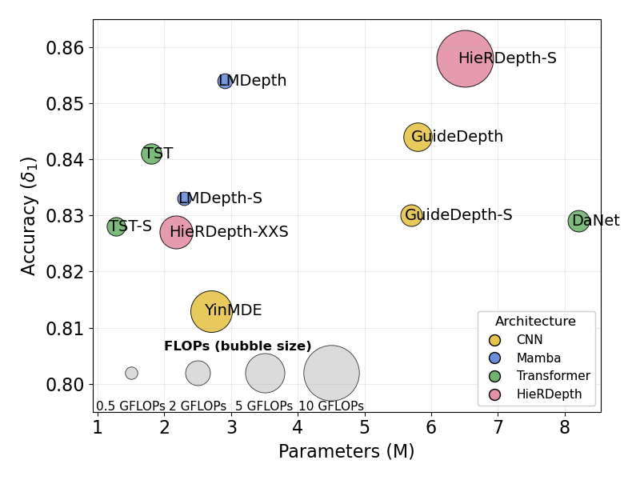

<div align="center">

# RePDepth: Redesigning Lightweight Monocular Depth Estimation Beyond Naive Compression

**Monocular metric depth estimation with a configurable lightweight backbone**

[](#paper)
[](https://github.com/Kai-Yin-UoA/RePDepth)
[](metric_depth/README.md)
[](LICENSE)

</div>

RePDepth is a monocular metric-depth estimation project. The implementation combines a configurable CNN or MobileViT backbone, a multi-scale DPT decoder, and a bin-based metric-depth head. Training and evaluation workflows for NYUv2 and KITTI are provided in [`metric_depth/`](metric_depth/).

<p align="center">
  
</p>

<p align="center"><em>Qualitative depth predictions on NYUv2 and KITTI. The figure compares RGB input, ground truth, and predictions from several methods.</em></p>

## Lightweight performance

The parameter–accuracy plots show that RePDepth's smaller variants retain strong accuracy with a compact model size. RePDepth-XXS uses about **2.2M parameters** on NYUv2 and **1.9M** on KITTI; the larger RePDepth-S variant uses about **6.5M** and **5.8M** parameters, respectively. Bubble size indicates FLOPs.

<p align="center">
  
</p>
<p align="center"><em>KITTI: parameter count versus δ₁ accuracy. “Ours-XXS/S” denotes RePDepth-XXS/S.</em></p>

<p align="center">
  
</p>
<p align="center"><em>NYUv2: parameter count versus δ₁ accuracy. The plot uses the project's previous name, HierDepth, for the XXS/S variants.</em></p>

The plots report δ₁ accuracy of approximately **0.827 / 0.858** for XXS/S on NYUv2 and **0.941 / 0.955** on KITTI. They illustrate the accuracy–efficiency trade-off across model sizes; FLOPs are represented by bubble area.

## Overview

- **Metric depth prediction:** estimate depth values from a single RGB image.
- **Configurable backbone:** select the encoder in [`config_zoedepth.json`](metric_depth/zoedepth/models/zoedepth/config_zoedepth.json), without editing the model source.
- **Training and evaluation:** use the existing ZoeDepth-based pipeline for NYUv2 and KITTI.

Supported `ENCODER` values include `mobilenetv2`, `mobilenetv3`, `mobilevit`, `mobilevitv1_xxs`, `mobilevitv1_xs`, `mobilevitv1_s`, and `mobilevitv3v2`.

## Training and data preparation

Training and dataset preparation follow the [Depth Anything metric-depth protocol](https://github.com/LiheYoung/Depth-Anything/tree/main/metric_depth). Prepare NYUv2 or KITTI with the same splits and preprocessing conventions, then set the dataset paths in `zoedepth/utils/config.py`. This repository uses the ZoeDepth data loading and training pipeline for metric-depth fine-tuning.

## Setup

```bash
cd metric_depth
conda env create -n repdepth -f environment.yml
conda activate repdepth
```

Prepare the NYUv2 or KITTI data and update the corresponding dataset paths in `zoedepth/utils/config.py` before training or evaluation.

## Train and evaluate

Run commands from the `metric_depth/` directory:

```bash
python train_mono.py -m zoedepth -d nyu
python evaluate.py -m zoedepth -d nyu -p "local::./checkpoints/repdepth_nyu.pt"
```

Replace the example checkpoint path with the checkpoint you want to evaluate. Use `-d kitti` to train or evaluate on KITTI. The evaluation script requires a trained checkpoint.

To switch the encoder, edit the `model.ENCODER` value in `zoedepth/models/zoedepth/config_zoedepth.json`. For example:

```json
"ENCODER": "mobilevitv1_s"
```

## Paper

The paper link and publication information are not available in this repository yet. They will be added here when released.

## Citation

There is no RePDepth BibTeX entry available yet. Please cite the relevant underlying methods and datasets when using this code.

## Acknowledgements

This project builds on [ZoeDepth](https://github.com/isl-org/ZoeDepth), [Depth Anything](https://github.com/LiheYoung/Depth-Anything), and MobileViT implementations included in this repository. Please see their respective projects for licenses and citations.
